# Solução do formulário de cadastro Gamer

## Descrição

O objetivo é criar um formulário responsivo de cadastro para uma rede de jogos competitivos, seguindo os layouts do Frontend Mentor. O projeto usa Angular, TypeScript e SCSS.

---

☰ LEGENDA:

- [✔] Tarefa concluída;
- [∎] Interrompida temporariamente;
- [◔] Em andamento;
- [⚠] Ainda não iniciada (Not started yet).

---

## Checklist dos principais objetivos do projeto

- [⚠] Estrutura inicial do projeto
  - [⚠] Configurar o Angular, o TypeScript e a compilação de estilos SCSS.
  - [⚠] Organizar a aplicação e seus componentes em `src/app/` e gerar os arquivos de build em `dist/`.
  - [⚠] Configurar as fontes locais Orbitron e JetBrains Mono.

- [⚠] Página principal e base visual
  - [⚠] Exibir o logotipo Neoncore, o título `// Join the nexus` e o subtítulo de identidade.
  - [⚠] Aplicar as cores, a tipografia, a escala de espaçamento, os cantos retos e o tema escuro do guia de estilos.
  - [⚠] Criar o layout de duas colunas para desktop e o layout responsivo de uma coluna para dispositivos móveis.
  - [⚠] Adicionar estilos visíveis ao passar o cursor e ao navegar por teclado, além de suporte à preferência por movimento reduzido.
  - [⚠] Comparar a página renderizada com todos os layouts fornecidos e ajustar as diferenças visuais em desktop (1440px), dispositivos móveis (375px) e larguras intermediárias.

- [⚠] Dividir a página em componentes reutilizáveis
  - [⚠] Definir os limites dos componentes e as responsabilidades de dados e eventos antes de dividir a estrutura atual da página.
  - [⚠] Criar os componentes do painel de marca e introdução e do resumo de status do operador.
  - [⚠] Criar componentes reutilizáveis para campos do formulário e campos de senha.
  - [⚠] Criar componentes para o indicador de força da senha e a caixa de seleção dos termos.
  - [⚠] Criar componentes para o formulário de conta e a tela de sucesso.
  - [⚠] Organizar o HTML, os estilos e o comportamento dos componentes em `src/app/` e compor a página com eles, em vez de manter toda a estrutura no componente raiz.

- [⚠] Comportamento do formulário de cadastro
  - [⚠] Adicionar os campos de identificador (Callsign), e-mail (Email), senha (Password), confirmação de senha (Confirm password) e termos de uso (Terms), com rótulos e validações nativas básicas.
  - [⚠] Adicionar uma dica sobre o formato do identificador (Callsign) e outra sobre o tamanho mínimo da senha.
  - [⚠] Validar o tamanho do identificador (Callsign), de 3 a 20 caracteres, e permitir apenas letras, números, `_` e `-`.
  - [⚠] Validar o formato do e-mail e exibir um erro para endereços inválidos.
  - [⚠] Validar o tamanho da senha (Password), de pelo menos 8 caracteres, e exibir a mensagem de erro apropriada.
  - [⚠] Validar se a confirmação de senha (Confirm password) corresponde à senha.
  - [⚠] Exigir a aceitação dos termos de uso (Terms) e da política de privacidade (Privacy Policy) antes de iniciar a criação da conta.
  - [⚠] Permitir mostrar e ocultar cada senha por meio de botões de olho acessíveis e operáveis pelo teclado, usando os ícones de olho/olho riscado fornecidos.
  - [⚠] Calcular a força da senha e exibir os estados Fraca (Weak), Razoável (Fair), Boa (Good) e Forte (Strong) mostrados nos layouts.
  - [⚠] Atualizar as validações e o feedback de status enquanto a pessoa edita os campos e altera o foco.

- [⚠] ID do operador e resumo de status dos campos
  - [⚠] Exibir o ID do operador (Operator ID), o nome inicial `Não atribuído (Unassigned)`, a contagem `0/5 prontos (0/5 ready)` e as cinco linhas de status iniciais.
  - [⚠] Exibir um identificador válido (Callsign) como nome do operador; caso contrário, manter o nome `Não atribuído (Unassigned)`.
  - [⚠] Atualizar a contagem de requisitos prontos conforme cada um dos cinco requisitos se torne válido.
  - [⚠] Manter o status de cada linha sincronizado com seu campo: `PENDING`, `OK`, `TOO SHORT`, `TOO LONG`, `BAD CHARACTER`, `MALFORMED`, `MISMATCH` ou `REQUIRED`.
  - [⚠] Após o cadastro, exibir `PROVISIONED` e bloquear as cinco linhas de status.

- [⚠] Estados de erro e acessibilidade
  - [⚠] Adicionar espaços inicialmente ocultos para mensagens de erro e os estilos visuais iniciais de erro.
  - [⚠] Exibir a mensagem de erro e o estado visual de inválido apropriados para cada campo inválido, incluindo o estado de erro de Terms.
  - [⚠] Associar cada dica e mensagem de erro ao respectivo campo usando `aria-describedby` e comunicar as mudanças de validação às tecnologias assistivas.
  - [⚠] Ao tentar enviar um formulário inválido, informar quantos campos precisam de atenção e mover o foco para o primeiro campo inválido.
  - [⚠] Verificar todo o fluxo do formulário usando apenas o teclado e conferir os rótulos, a ordem de foco e os anúncios do leitor de tela.

- [⚠] Envio e estados de sucesso
  - [⚠] Criar a estrutura inicial da tela de sucesso e um espaço visual provisório para a ação da conta.
  - [⚠] Enviar o formulário somente depois que os cinco requisitos forem válidos.
  - [⚠] Exibir o estado de carregamento `Transmitting_` e impedir envios duplicados enquanto ele estiver ativo.
  - [⚠] Exibir o estado de sucesso com o identificador do operador e uma ação funcional “Continuar para entrar” (“Continue to log in”).
  - [⚠] Alterar o resumo do operador para `PROVISIONED` e bloquear as linhas de status após o sucesso.

- [⚠] Estados visuais a verificar
  - [⚠] Formulário inicial e preenchido:
    - 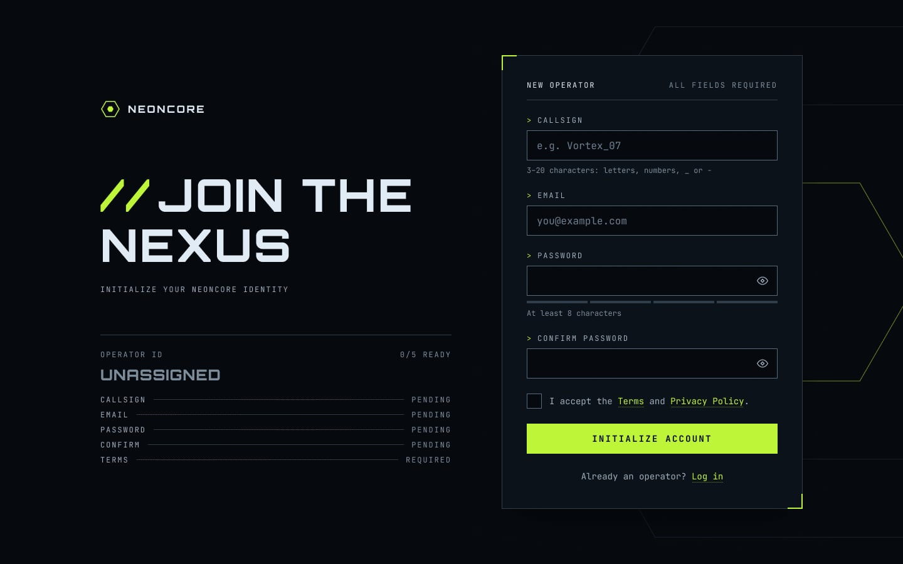
    - 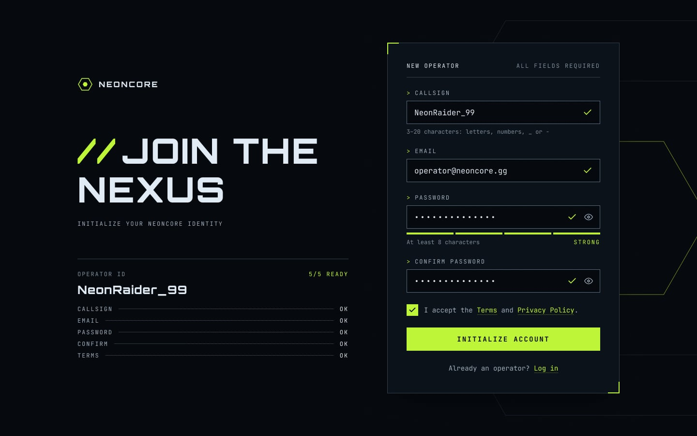
    - 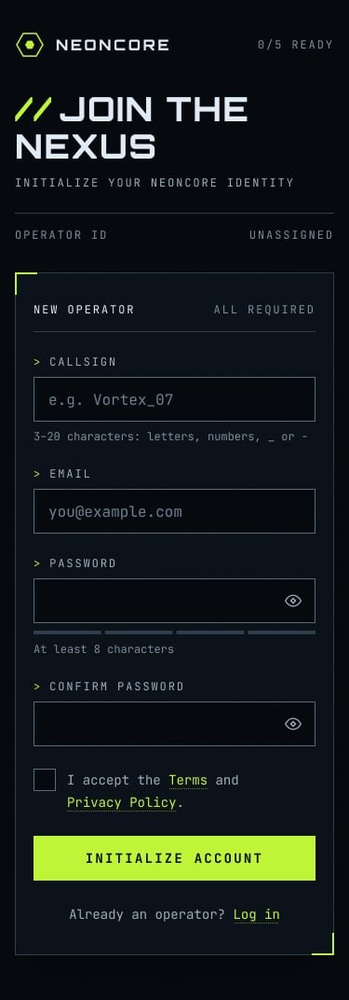
    - 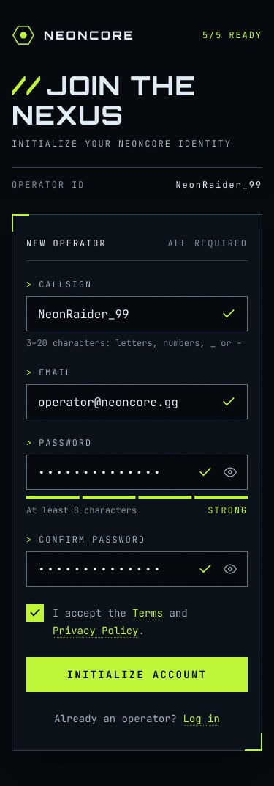
  - [⚠] Erros de validação e de termos:
    - 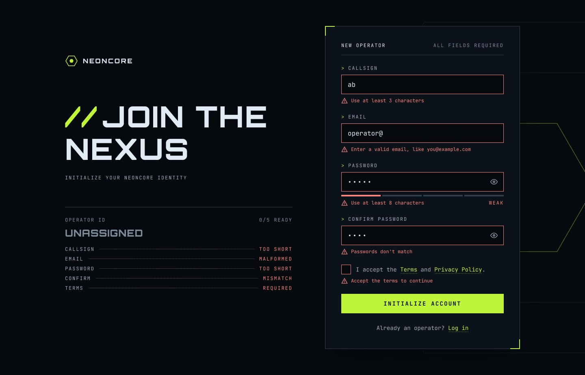
    - 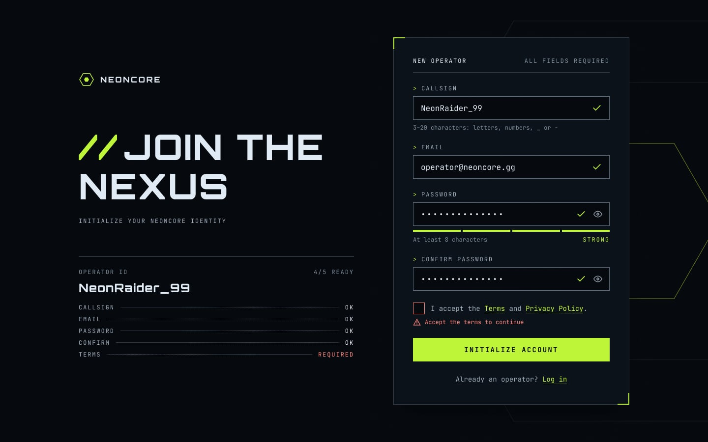
    - 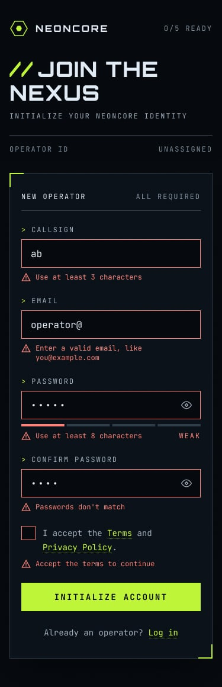
  - [⚠] Visibilidade e força da senha:
    - 
    - 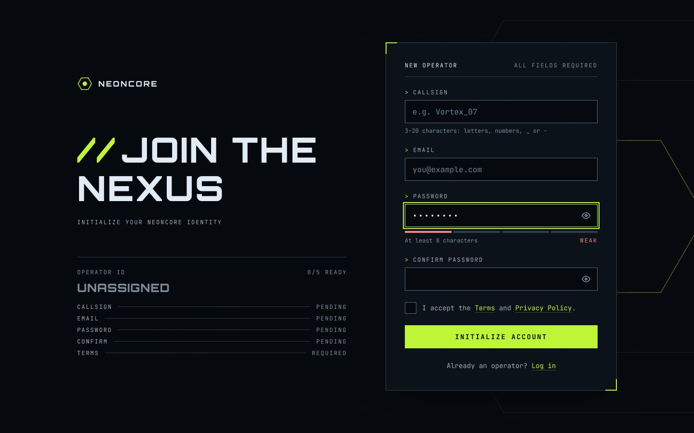
    - 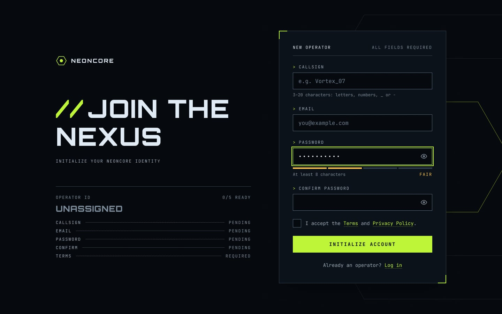
    - 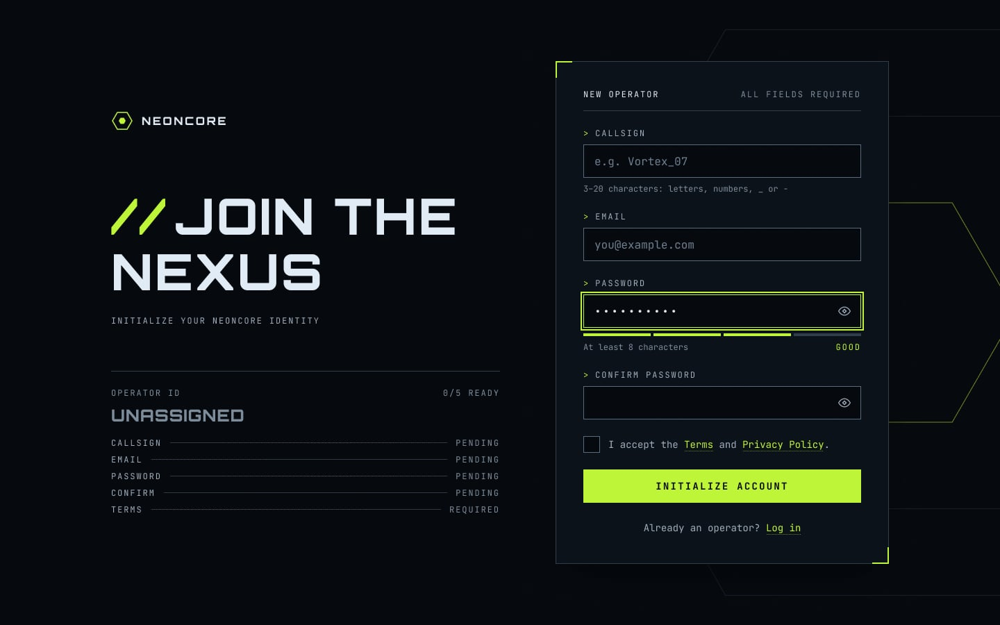
  - [⚠] Envio e sucesso:
    - 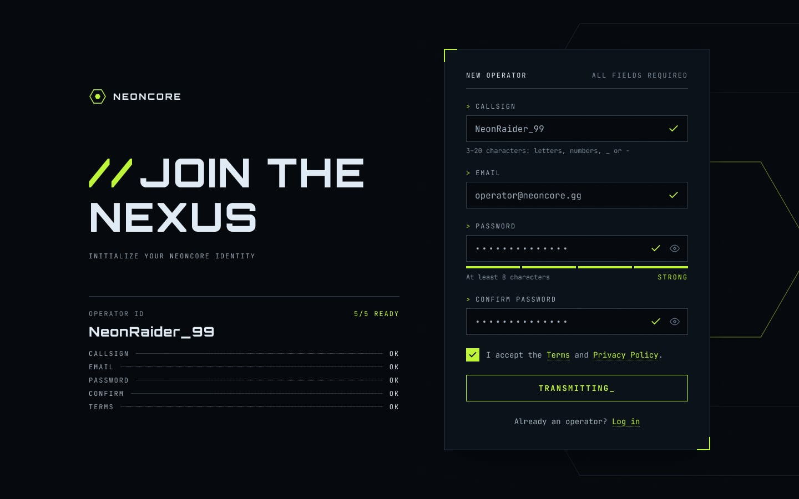
    - 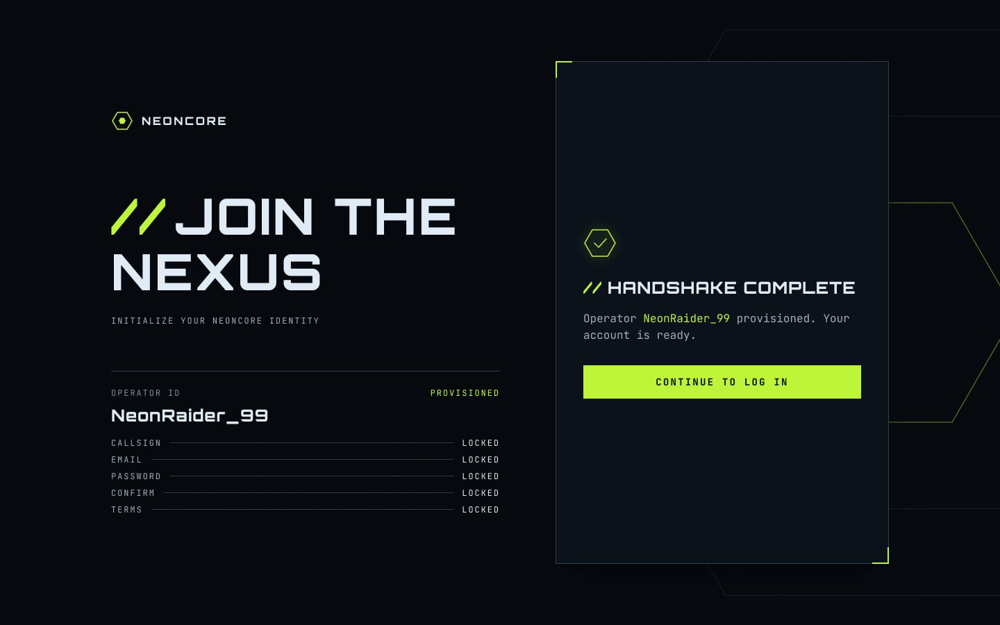
    - 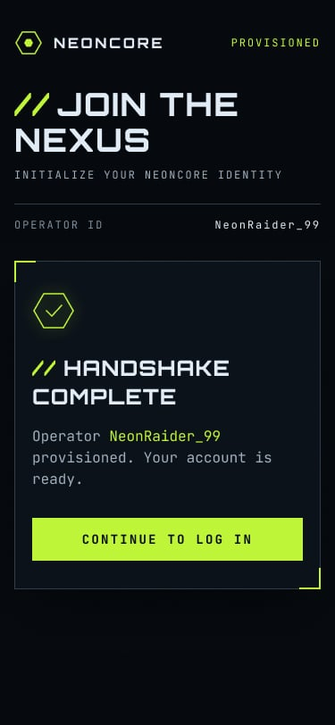
  - [⚠] Estilos interativos:
    - 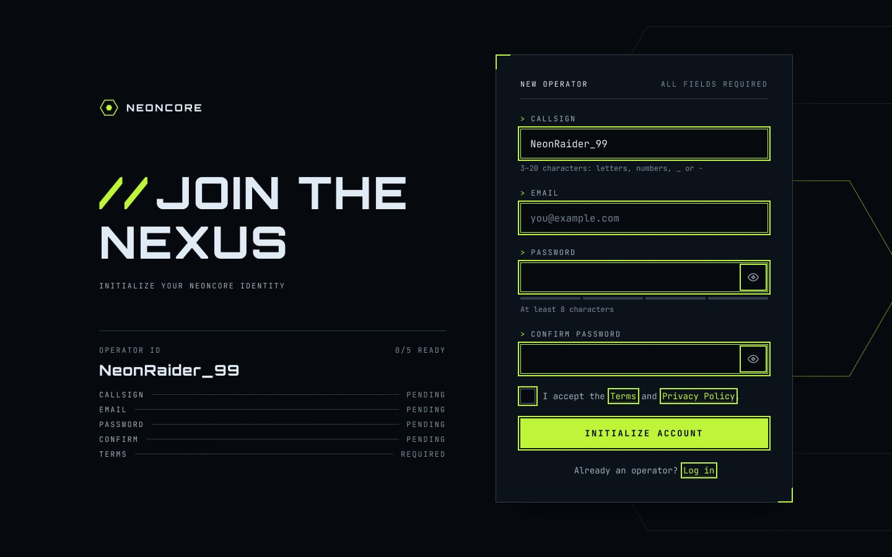
    - 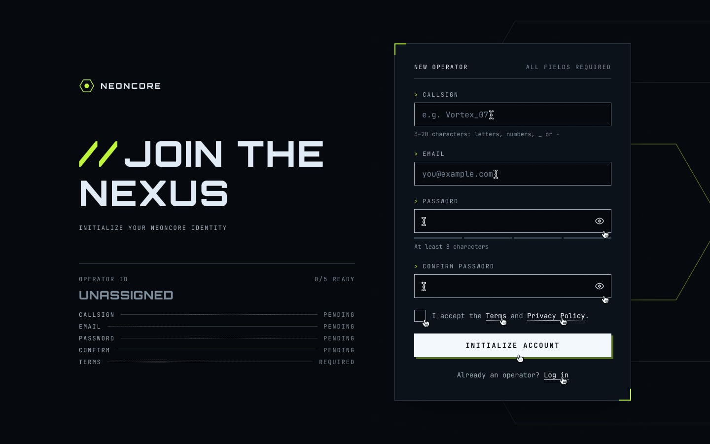
